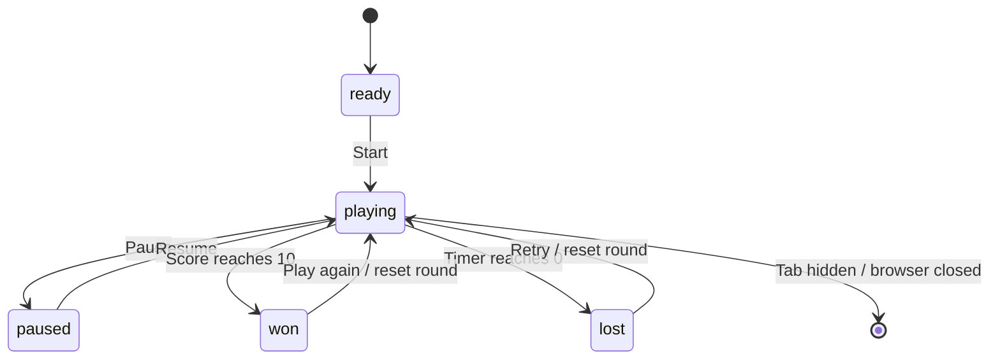

# Neon Collector — Game Design Document

**Task 03:** Game State, Progression, and Persistence  
**Genre:** 2D arcade / time challenge  
**Platform:** Web browser  
**Audience:** Casual players, teens and adults, and beginner game developers  
**Round length:** 30 seconds

## Concept and Objective

Neon Collector is a short arcade game set in a neon digital arena. Move a glowing character, collect energy orbs, and avoid red hazards. Collect 10 orbs before time expires to win.

## State Model

The game uses explicit states: `ready`, `playing`, `paused`, `won`, and `lost`. A transition guard only allows expected changes. The restart action from `won` or `lost` resets round-only data and begins a new `playing` round. Pause is allowed only while playing; resume is allowed only while paused. Repeated start actions while already playing are ignored.

## Rules, Scoring, and Progression

- The round starts with 30 seconds and a score of zero.
- Each collected orb adds one point.
- Collecting 10 orbs wins the round immediately.
- The timer reaching zero before 10 points results in a loss.
- Colliding with a red hazard costs two seconds and returns the player to the starting area.
- After the fifth orb, hazards become 35% faster for the rest of that round. The HUD changes from `STANDARD` to `INTENSE`.
- The player cannot leave the arena boundaries.

## Persistence

The best score is saved locally using browser `localStorage` under `neonCollector.bestScore.v1`. It updates whenever the current score exceeds the previous best. The value is validated when read and capped to the valid score range. If browser storage is unavailable, the game continues to work for the current session.

The current score, timer, player position, hazards, and particles are temporary round state. Restart resets these values but does not erase the saved best score.

## Controls

| Action | Input |
|---|---|
| Move | WASD or arrow keys |
| Pause / resume | Space or P |
| Start / retry | On-screen button or Enter |
| Mobile movement | Touch and drag inside the arena |

## Feedback States

- `ready`: instructions and Start Mission button.
- `playing`: active HUD and gameplay.
- `paused`: gameplay is frozen and Resume is available.
- `won`: success message, final score, best score, and Play Again.
- `lost`: final score, best score, and retry action.

## Design Intent

The state guard makes invalid actions harmless. The best score persists across page refreshes on the same browser. Difficulty progression adds a clear challenge without introducing extra levels or complex assets.
